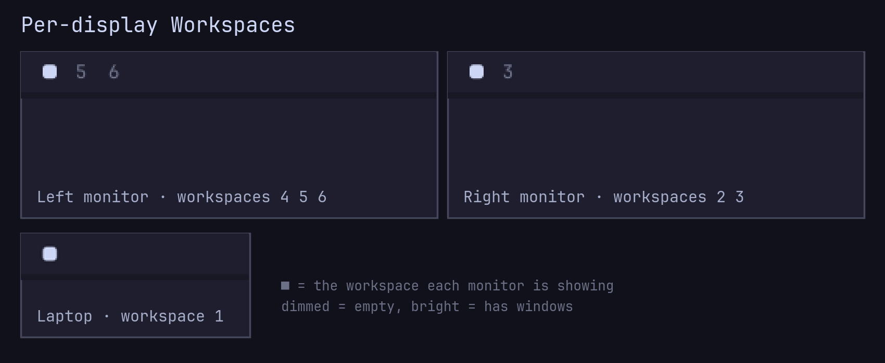

# Per-display Workspaces

An [Omarchy](https://omarchy.org/) bar widget that gives every monitor its own
workspace list. Each bar shows only the workspaces that live on its monitor
and marks the one that monitor is currently showing.



The built-in Workspaces widget draws the same list on every bar: workspaces
1–5 plus any others that exist, with only the globally focused one marked. On
a multi-monitor desk that makes it hard to tell which workspaces are where.

## Features

- **Per monitor:** each bar lists only the workspaces on its own monitor.
- **Shown workspace marked on every bar:** the ■ follows what each monitor is
  displaying, not just the focused monitor.
- **Live:** when workspaces move between monitors (moving a workspace,
  plugging in a display, closing the lid in clamshell mode, workspace rules
  changing), every bar updates immediately.
- **No Hyprland changes:** it only reads where your workspaces already are, so
  it works with whatever assignment you use: `hl.workspace_rule`, scripts,
  or moving workspaces by hand. No keybindings or config are touched.
- **Drop-in:** enabling it takes the built-in Workspaces widget's place on the
  bar; removing it puts the built-in one back.

Workspaces with windows are bright, empty ones are dimmed, and clicking a
number switches to it, just like the built-in widget. Workspaces 1–10 are
shown; special workspaces (scratchpad) are not.

## Requirements

- Omarchy 4 (Quattro) with the Omarchy shell bar.
- No other dependencies.

## Omarchy 4.5 and later

Omarchy 4.5 gives every monitor its own block of ten workspace ids (1–10,
11–20, 21–30, …), and its built-in Workspaces widget already shows each
monitor's own workspaces. If you are happy with that scheme, you don't need
this widget.

This widget is for a global numbering, where each number is one workspace that
your rules or scripts place on a fixed monitor. On 4.5, Omarchy reconciles
workspaces into its blocks on every start, config reload and monitor change:
it renumbers workspaces (for example 1–6 to 21+ on a laptop panel) and moves
them to the monitor that owns their block, so ids above 10 appear that this
widget doesn't show. To keep a global numbering on 4.5, add both of these to
your Hyprland config, after Omarchy's defaults:

```lua
-- Stop Omarchy's per-monitor reconciler. Its event handlers look this function
-- up when they run, so a no-op leaves workspace placement to your own rules.
o.workspaces.reconcile = function() end

-- SUPER + 1…0 now go to a slot in the focused monitor's block. Put back the
-- 4.0 bindings, where each number is one workspace.
for workspace = 1, 10 do
  local key = "code:" .. tostring(workspace + 9)
  o.rebind("SUPER + " .. key, "Switch to workspace " .. workspace, hl.dsp.focus({ workspace = tostring(workspace) }))
  o.rebind("SUPER + SHIFT + " .. key, "Move window to workspace " .. workspace, hl.dsp.window.move({ workspace = tostring(workspace) }))
  o.rebind("SUPER + SHIFT + ALT + " .. key, "Move window silently to workspace " .. workspace, hl.dsp.window.move({ workspace = tostring(workspace), follow = false }))
end
```

`o.workspaces.reconcile` is internal to Omarchy, not a documented setting, so
check it still exists after each `omarchy update`. Omarchy 4.5 also moved
`SUPER + SHIFT + ALT + arrows` (move workspace to monitor) onto its blocks; to
restore those, rebind them to `hl.dsp.workspace.move({ monitor = "l" })` and
the matching `r`, `u` and `d`.

## Install

```bash
omarchy plugin add https://github.com/DarioBF/per-display-workspaces --enable
```

The widget takes the built-in Workspaces widget's place and settings. Run from
a terminal, the installer asks which bar section to put it in (left by
default). Move it later like any other widget:

```bash
omarchy bar move io.github.dariobf.per-display-workspaces --section center --index 0
```

## Remove

```bash
omarchy plugin remove io.github.dariobf.per-display-workspaces
```

This deletes the plugin folder (Omarchy keeps a backup) and restores the
built-in Workspaces widget where this one was.

## Development

The widget is a single file, `Workspaces.qml`. After editing an installed
copy, run `omarchy restart shell` to load the change.

## License

[MIT](LICENSE)
